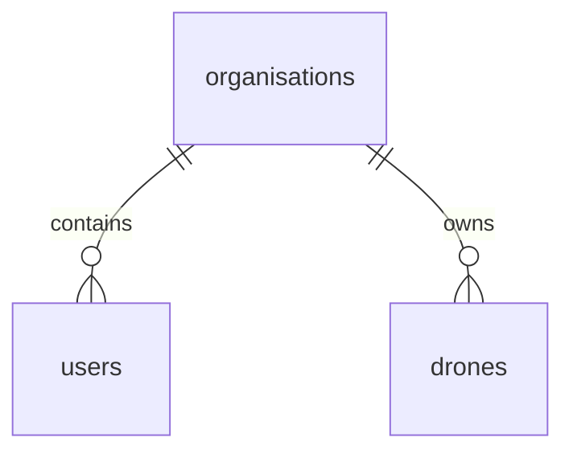

# Core database schema

The first application migration adds organisations, users, and drones. UUID primary keys are generated by PostgreSQL; timestamps use `timestamptz`. Store instants and return them as UTC ISO 8601 values in the API. `created_at` defaults on insertion; triggers maintain `updated_at` on updates.

## Relationships

System administrators are the exception: they have no organisation. Every other user has exactly one organisation and one role. Multi-organisation memberships are outside this initial design.

## Tables

| Table | Fields and rules |
| --- | --- |
| `organisations` | UUID, trimmed nonempty name, creation and update timestamps. Names need not be globally unique. |
| `users` | UUID, organisation, name, canonical globally unique email, password hash, role, active flag, timestamps. |
| `drones` | UUID, organisation, name, vendor, model, serial number, status, last telemetry timestamp, timestamps. |
| `schema_migrations` | Migration filename without extension, SQL checksum, application timestamp. Managed by the runner. |

User roles are `system_administrator`, `fleet_manager`, `pilot`, and `maintenance_technician`. A check constraint requires an organisation for tenant roles and forbids an organisation for system administrators. Deactivate users with `is_active = false`; authentication must reject inactive users. Account invitation/token storage will be added with authentication. Password hashes are required; the authentication service must generate and verify Argon2 or bcrypt hashes. The database only rejects empty hashes and cannot prove a value is securely hashed.

Emails must already be trimmed and lowercase. Global uniqueness gives login one unambiguous account per email. The API must normalize and validate addresses before insertion. Names, models, and serial numbers are trimmed and limited to 200 characters.

The initial vendor codes are `dji` and `ardupilot` (integrated via MAVLink). CSV is a fallback input format, not a vendor. Vendor credentials and adapter configuration are outside this schema. Adding a vendor requires a migration to update the constraint.

Drone serial numbers are case-sensitive and unique within `(organisation_id, vendor, serial_number)`. Separate tenants can store the same vendor/serial identity; this is not a global ownership registry. Display names are not unique. The fleet/status index supports tenant fleet queries; the serial constraint also indexes the tenant prefix.

Drone statuses are `available`, `charging`, `in_mission`, `grounded`, and `unknown`. New registrations default to `unknown`, with `last_telemetry_at = NULL`. Metadata updates never advance telemetry freshness. The ingestion/status service must update telemetry timestamps and determine stale status; the database does not automatically expire status values. A future maintenance workflow must make grounding take precedence over telemetry status.

Deleting an organisation cascades to its users and drones, as the requirements allow organisation removal. Other tenants and system administrators are unaffected. No delete API exists yet; authorization and an explicit deletion workflow must be implemented before exposing this operation.

## Isolation and future tables

Tenant foreign keys and indexes establish ownership; they do **not** enforce caller permissions or filter queries. Row-level security is not enabled. Before exposing application endpoints, implement shared organisation scoping and role checks, and test cross-organisation access. Never treat a client-supplied organisation ID as authorization.

Future tables that reference a tenant-owned user or drone should carry `organisation_id` and use composite foreign keys to prevent cross-tenant relationships. Add the corresponding `(organisation_id, id)` unique keys when those relationships are introduced.

Telemetry hypertables, mission assignments, maintenance records, append-only audit events, sessions, and AI preferences are intentionally deferred. This migration does not implement the full requirements model.

## Migration operation

Run `./backend/scripts/migrate.sh` from any directory. It applies the TimescaleDB extension migration and then the core schema, recording checksums. An old volume with the extension already installed is supported because the original extension migration is idempotent. The whole batch rolls back on a SQL error or checksum mismatch. Do not edit applied files or run migration SQL manually; add a subsequent numbered SQL file and use the runner.

The Compose database role is a local development owner. Production application connections should use a separate restricted role; production role provisioning is outside this local setup.
