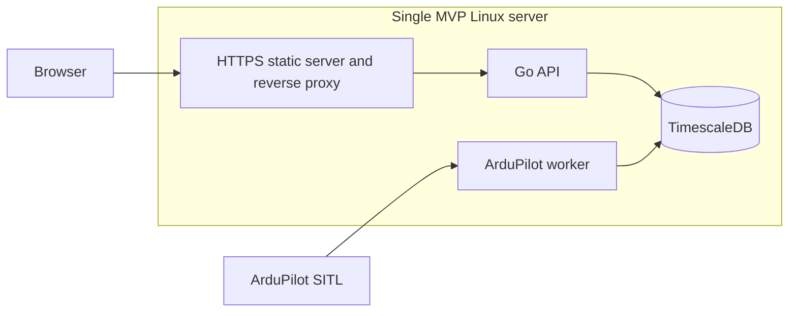

# MVP stack and server decision

Recorded 2026-10-29. Owner: Omar. Scope: Sprint 1 platform, R-15, SOC-05.

## Decision

Keep Go, React/TypeScript, and TimescaleDB on one server for the MVP. The functional [R-15 spike](spikes/R15.md) passed; there is no evidence requiring a stack change. This records the current implementation and deployment design, not a deployed production environment.

| Component | Choice | Reason and boundary |
| --- | --- | --- |
| Backend | Go 1.26+, standard `net/http`, `pgx/v5` | One API process with context cancellation, a bounded database pool, typed interfaces, and transactions shared by registry/audit writes. The module pins dependencies. |
| Frontend | React + TypeScript; Vite for development/build | Existing fleet/authentication screens share the REST API. Production serves built static files; Vite is the development server. |
| Storage | TimescaleDB 2.26.0 on PostgreSQL 17, pinned in Compose | One database supports relational tenant/registry/audit data and time-series telemetry. It avoids a separate telemetry datastore. |
| Integration | Separate ArduPilot MAVLink worker; gomavlib v4 | One configured SITL endpoint per registered drone. The current worker calls the normalized ingestion store; connector management and staged pipeline integration remain team handoffs. |
| Development | Docker Compose database, Go and Node tools on the host | The checked-in Compose file starts the database only. API/frontend/worker launch commands remain explicit. |
| MVP hosting | One Linux server, one database instance | Co-locate static web serving/reverse proxy, API, workers, and database. No cluster or high availability. No cloud provider or paid service is required by this decision. |

## Single-node topology

The proxy serves the frontend and forwards `/api` to the API on the same origin. TLS terminates at the proxy, with secure cookies and an exact configured `APP_ORIGIN`. Keep API/database ports private; Compose already binds the database to loopback. Configure an internal MAVLink link for SITL; public unauthenticated flight-controller exposure is outside this setup.

Server sizing is undecided until the Sprint 2 workload test and measured database growth establish a baseline. This decision selects a topology, not a hardware capacity or hosting provider. Hosting, storage, and operational time still need a deployment budget.

## Consequences and operating limits

- A single host failure stops the service. The 99% uptime target is a design target, not a demonstrated availability result.
- A named Compose volume persists database files across container restarts. It is not an off-server backup or a tested disaster-recovery procedure.
- Production needs restricted database credentials, HTTPS, backups and restore verification. The Compose database owner is for local development.
- The ingestion store currently writes one normalized observation per transaction. Batch writing, retention/compression policies, rated battery-cycle tracking, and new-telemetry events remain Ziad's work.
- The adapter's buffer is bounded and in memory. It does not establish durable queuing or complete connector/pipeline orchestration.
- Keep applied migrations immutable. Add a numbered migration for schema changes; the runner rejects checksum changes and serializes concurrent runs.

## Revisit triggers

Revisit sizing or process boundaries if the agreed 1,000-drone workload, history queries, or concurrent users miss the requirements. Revisit the single-server choice if measured availability or recovery needs require another host. Record measurements before changing the stack or claiming NFR-01/NFR-02 compliance.

Implementation references: [Compose](../compose.yaml), [schema](../backend/SCHEMA.md), [authentication](../backend/AUTH.md), [telemetry](../backend/TELEMETRY.md), [SITL integration](../backend/ARDUPILOT.md).
